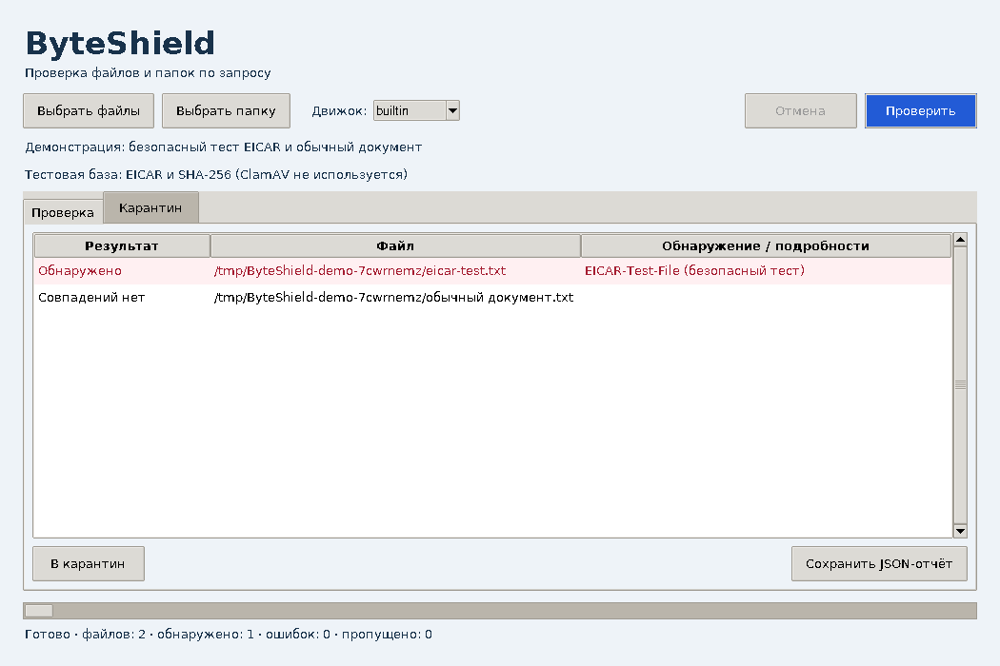

# ByteShield

Я делаю небольшой антивирус для проверки файлов и папок. В первой версии есть окно программы, сканер, карантин и сохранение отчёта. Программа работает локально и не отправляет файлы в интернет.



## Что уже работает

- Проверка выбранных файлов и папок, включая вложенные.
- Поиск по SHA-256 и обнаружение безопасного тестового файла EICAR.
- Подключение ClamAV, если `clamscan` установлен и его базы готовы.
- Перенос выбранного обнаруженного файла в карантин.
- Восстановление копии из карантина без перезаписи существующих файлов.
- Сохранение JSON-отчёта, отмена проверки, отдельный учёт ошибок и пропусков.

**Это первая версия с проверкой по запросу.** Без ClamAV в комплекте только тестовая база EICAR: она нужна для проверки работы программы, а не для поиска всех реальных вирусов. ByteShield не заменяет Microsoft Defender, не следит за системой в реальном времени и не проверяет процессы или память.

## Запуск

Нужен **Python 3.10 или новее**. Для запуска окна:

```bash
git clone https://github.com/ztfy404/ByteShield.git
cd ByteShield
python app.py
```

В Windows Tkinter обычно устанавливается вместе с Python. В Debian/Ubuntu, если его нет:

```bash
sudo apt install python3-tk
python3 app.py
```

В окне выберите файлы или папку и нажмите **«Проверить»**. Режим `auto` использует ClamAV, если находит `clamscan`; иначе прямо показывает, что работает тестовая база. Само сканирование ничего не удаляет. Карантин включается отдельной кнопкой с подтверждением.

## Версия для Windows без Python

Сборка `ByteShield.exe` запускается в [GitHub Actions](https://github.com/ztfy404/ByteShield/actions). После успешной сборки откройте запуск **Tests and Windows build** и скачайте артефакт **ByteShield-Windows**. В `.exe` входит интерфейс и встроенный сканер; ClamAV устанавливается отдельно.

## Проверка из терминала

```bash
python -m byteshield scan "путь/к/папке" --report report.json
python -m byteshield scan "путь/к/файлу" --engine builtin
python -m byteshield scan "путь/к/папке" --engine clamav
```

По умолчанию файлы больше 128 МиБ пропускаются. Лимит можно изменить через `--max-size-mb`. В отчёте есть статусы `detected`, `no_match`, `error` и `skipped`. `no_match` означает отсутствие совпадений у выбранного движка, а не гарантию безопасности.

Подробнее: [использование и ClamAV](docs/usage.md), [устройство проекта](docs/architecture.md).

## Проверки

```bash
python -m unittest discover -s tests -v
```

Я добавил тесты для сканирования, сигнатур, ошибок ClamAV, карантина и восстановления. Оконный тест запускается при наличии X-дисплея; без него пропускается. Сценарий с настоящим ClamAV нужно отдельно проверять после установки его баз: в модульных тестах ответы внешнего движка подменяются.

На скриншоте — настоящее окно программы с безопасным тестом EICAR и обычным документом.
